

[14–0](https://14-0.net) is a free browser game built on 40 years of Breeders' Cup history. You draft one horse for each of the 14 Breeders' Cup races from every running since 1984, then sim the card, watch each race, or ride it yourself, at the track where that year's race was run. This year it also had the real 2026 fields at Keeneland, live multiplayer races and an always-on TV channel.

In this post, I go through how the game actually works - how a race is drawn, how the ratings are kept honest across eras and surfaces, what goes into watching and riding a race, and how multiplayer and TV fit on top. It's a long one. I've put a significant amount of effort into making the game both approachable and accurate to the spirit of the sport, and this post is mostly about that.

<!-- more -->

### Churchill Downs, 2010

Back in 2010, the year [Blame beat Zenyatta](https://en.wikipedia.org/wiki/2010_Breeders%27_Cup_Classic), I built a very simple and frankly unimpressive fantasy game for the Breeders' Cup. I was on the Breeders' Cup Fan Advisory Council (they'd found a few of us through social media), and the council held a draw to decide who would go to the track. I have a feeling they rigged it in my favor.

It turned out to be my honeymoon. I'd gotten married a few days before, and we spent both days at Churchill Downs.

<div style="display:flex;gap:8px;flex-wrap:wrap;align-items:flex-start">
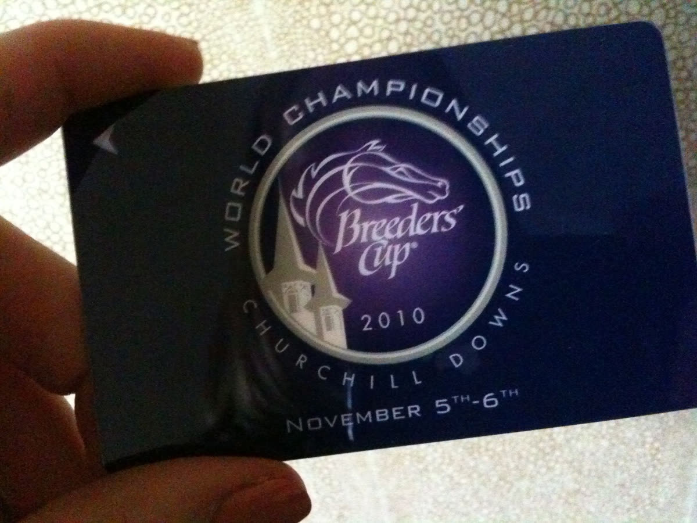
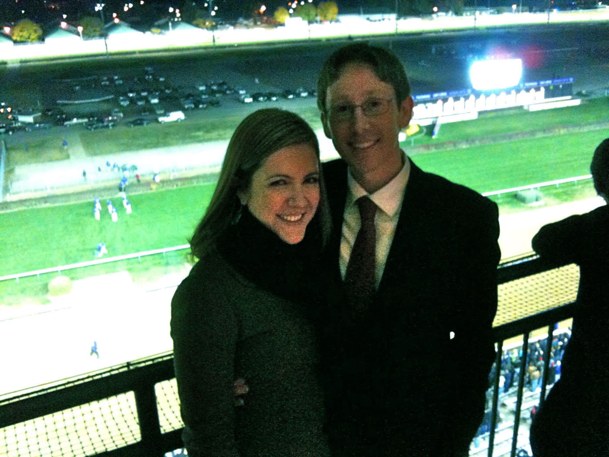
</div>
<p class="caption-text" style="text-align:center">Churchill Downs, November 2010</p>

The first version of the game had you pick a winner to stay alive. Midway through day one, [Shared Account](https://sagamorefarm.com/news/espn-com-shared-account-surprises-in-fm-turf-5/) won the Filly & Mare Turf at 46-1 and knocked everyone out. So I stayed up all night and rewrote it around a budget. Morning-line odds set each horse's price, you had a limited bank balance, and you had to decide where to single and where to spread. It launched that Saturday morning and worked a lot better.

<div style="display:flex;gap:8px;flex-wrap:wrap;align-items:flex-start">


</div>
<p class="caption-text" style="text-align:center">Louisville, that weekend</p>

My father, who's not much of a racing fan, entered to support me. Going into the last race he was first or second, and I was dreading him winning and me being accused of rigging it. Luckily someone else came through.

That game was the [small social app for the 2010 Breeders' Cup]() I mentioned when I left SportsLabs. Sixteen years later, I watched this year's Breeders' Cup at home, with a much bigger game running alongside it.

### From 82–0 to 14–0

This summer, I built a horse racing version of [82–0](https://aftermath.site/82-0-free-basketball-game-browser), the viral basketball game where you build a roster from NBA history and try to go undefeated. Racing doesn't have a season, but the Breeders' Cup has 14 championship races across two days, so 14–0 was the obvious name.

The 14 divisions are drafted in a fixed order, ending with the Classic:

> Juvenile Turf Sprint · Juvenile Fillies · Juvenile Turf · Juvenile · Filly & Mare Sprint · Turf Sprint · Dirt Mile · Filly & Mare Turf · Sprint · Mile · Distaff · Turf · Juvenile Fillies Turf · Classic

Each race starts with a spin that lands on a year, and you pick one horse from that year's field. You can't use the same year twice. Each division also has its own span of years, so the Juvenile Turf Sprint (first run in 2018) can't land on 1991. Once all 14 picks are in, each one runs against a field drawn from across the eras.

The archive covers 422 Breeders' Cup races from 1984 to 2025: 1,266 starts by 1,097 horses.

There are two modes. **Weekend Warrior** (originally called Claimer) shows you each horse's rating and gives you two re-spins. **Railbird** hides the ratings, lists each field A to Z, spins three years at a time and gives you one re-spin. It's your memory against the field.

<div style="display:flex;gap:8px;flex-wrap:wrap;justify-content:center">
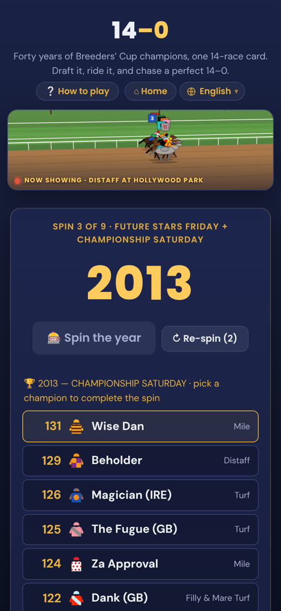
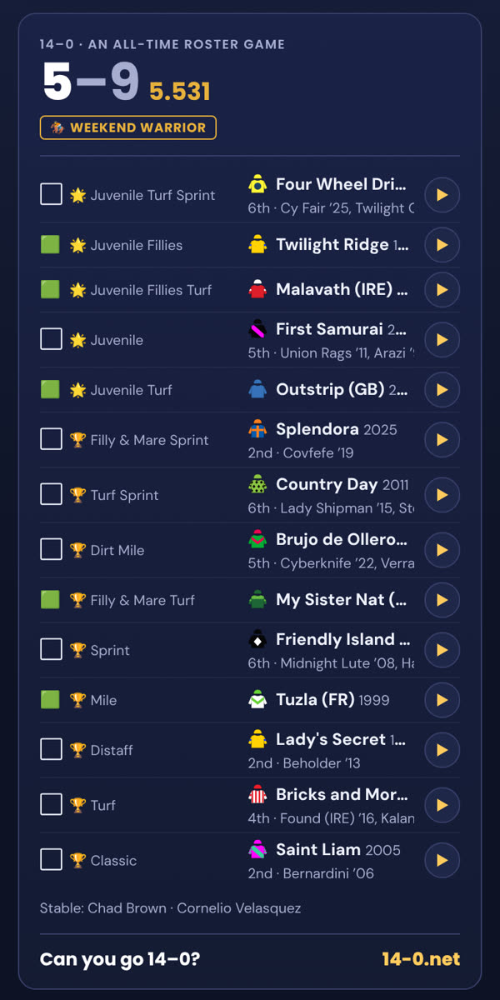
</div>
<p class="caption-text" style="text-align:center">The draft, and a finished card</p>

I made it for myself, really. The player I had in mind was someone super knowledgeable about the history of racing, who follows Grade 1s around the world. If you remember that Arazi won the Juvenile by five lengths, or that [Dangerous Midge](https://en.wikipedia.org/wiki/Dangerous_Midge) won the 2010 Turf, you'll recognize most of what the spins throw at you. (I tipped Dangerous Midge to somebody in person that day. They thought I was a genius. I still like seeing his name pop up.)

[Ed DeRosa](https://x.com/EJXD2) and the handicapper [Andrew Champagne](https://x.com/AndrewChampagne) were the first people to play it seriously, and both helped shape that first draft version. Andrew went 14–0, something I have never done. The next day, I made the game harder.

<blockquote style="margin:1.5em 0">
It's an addictive game fans of the sport's champions will love. … I believe I posted the first 14-0 mark in the game's history Thursday night.
<span style="display:block;margin-top:.5em;font-size:.85em">Andrew Champagne, in his <a href="https://andrewchampagne.com/2026/07/02/saratoga-race-course-analysis-selections-and-bankroll-for-saturday-july-4th/">Saratoga analysis for July 4th</a></span>
</blockquote>

In its first ten days, 14–0 was played 143 times, and 91% of those plays finished all 14 picks. Then the interest petered out, and it sat there until October.

### How a race is drawn

The first problem with a game like this is that you can't just compare ratings. A horse's performance rating is only meaningful relative to the horses it ran against. A turf router and a dirt sprinter don't share one scale, and turf routes in particular tend to rate lower than they should. So the game never compares a rating across divisions. Every field is anchored to its own division's best and worst.

The second problem is that the rating a horse earned in its Breeders' Cup isn't necessarily how good it was. Pace makes figures. The rabbit in a Classic that goes off at a suicidal clip can come out of the race with a big number it never earned on merit. So each horse carries a "true talent" number instead. It blends that day's figure with how good the horse was over its whole season, and where there's nothing else to go on, with what the market thought of it. The raw as-raced figure isn't shipped at all.

Each horse has two numbers: a `center` (what it would be expected to run, and the number Weekend Warrior shows you) and a `ceiling`, which is how much upside it has above that. The upside comes from its odds:

```
volatility(odds) = 3.0 + 8.0 · p        where p = 1 / (odds + 1)
ceiling          = center + volatility
```

That means the favorites are the most volatile horses in the game, which makes sense when you think about it. A heavily bet favorite that ran below itself had hidden upside - the market knew it was better than that one figure. A longshot that ran to its form doesn't have much more in it. Meadow Star, Flightline, Zenyatta and Personal Ensign all have some of the widest bands.

When a race is run, every horse draws one performance for the day:

```
span        = max(2, ceiling − center)
performance = center + 0.45·span + gauss() · (5.5 + 0.45·span)
```

`gauss()` is an ordinary bell curve with no upper or lower bound, so any horse can beat any horse on the day. Zenyatta can beat Flightline. That property is what keeps every race worth watching.

#### Who you run against

Your rivals are real horses, drawn from that division's pool across all years, weighted toward the better ones so a loss is more likely to come at the hands of a horse you recognize. Rivals only ever come from that pool, which matters for reasons I'll get to below.

Drawing the top three from every year straight into one race would give you a field of champions, though, and that isn't what a Breeders' Cup looks like. So the field is re-leveled into a taper: the strongest rival anchors at the division's genuine best, and the rest step down towards an outsider. A lesser horse that's drawn into the back of the field runs like the outsider it would have been in a championship race. Each field also draws a depth, so some years are deep and some are soft, the way real Breeders' Cups vary.

Fields are the real size too. Every race used to have eight runners. Now each division runs its median Breeders' Cup field size, from 9 in the Dirt Mile to 14 in the Juvenile Turf, Turf Sprint and Juvenile Fillies Turf.

#### How rare a 14–0 should be

Your pick and your rivals come from the same pool, so without some help, every race is close to a coin flip, even with the best horse. Fourteen coin flips in a row is about 1 in 16,000. That's the same problem 82–0 has, and there it's part of the joke - no NBA team has ever gone 82–0. I wanted 14–0 to be rare but reachable.

So your pick gets a flat edge on its performance, `PLAYER_EDGE`, and how big it is gets settled by Monte Carlo runs: thousands of simulated drafts by a drafter who always takes the best horse on offer. Any change to a rating or a setting means running them again. A ratings change on its own once moved a perfect card from about 1 in 280 to about 1 in 1,700, without anyone touching the edge.

Today, a drafter who always takes the best available horse wins about 8.5 of 14 in Railbird and goes 14–0 about once in every 1,300 cards. In Weekend Warrior, your stable (the trainer and jockey spins) adds a small boost, and a sharp drafter with a strong stable gets there about once in every 110 cards. Quick 14, which picks for you, leans toward the stronger horses but still lets the occasional rank outsider through.



#### What the results should look like

The last check is whether the results look like Breeders' Cup results. They didn't, at first. Real Breeders' Cup winning margins have a median of about a length, and 90% are four lengths or less. The game's median was two and a half, with almost one race in ten won by eight lengths or more. The favorite was winning about as often as it really does (around 35% in the game, 34% in real life), so it wasn't too much luck - it was how many lengths a rating point was worth. Fixing that brought the median down to 1.3 lengths.

Then I noticed the rest of the field was too bunched. So the gaps are now mapped position by position onto the real medians: second is about a length behind the winner, third about two and a half, and the last horse in a big field is well strung out. The finishing order doesn't change, only how it's spread out.

I also looked at whether post position should matter. Across the Breeders' Cup's own history, the draw has made some difference at a handful of courses, but it's small next to the luck already in the draw, and a game field isn't a real draw anyway (rivals come from different years, so they get shuffled into free gates). The ratings already carry it, because each horse earned its rating from the post it actually had. So posts are shown, but the sim never reads them.

### Watching a race

The race feels like a race. Horses move at different times. They come in, they jostle, they have close finishes. Each race is not the same race repeated.

Watching is meant to feel like a TV broadcast. The camera cuts from the gate, to side-on down the backstretch, high and wide into the far turn, head-on down the stretch, and side-on at the wire. There's a race caller, fractions, and a running order with the odds and the favorite marked.

<div style="display:grid;grid-template-columns:repeat(auto-fit,minmax(260px,1fr));gap:8px">
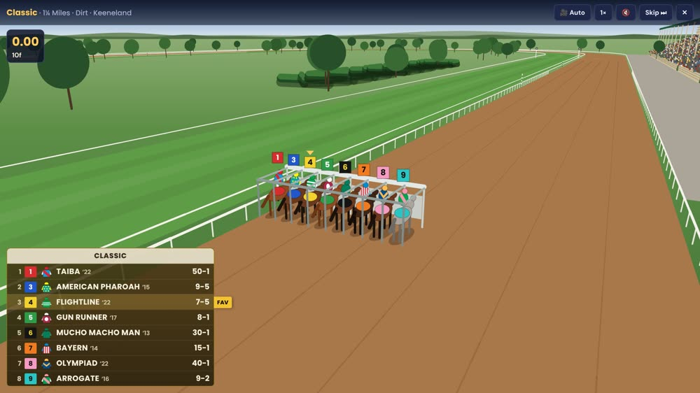
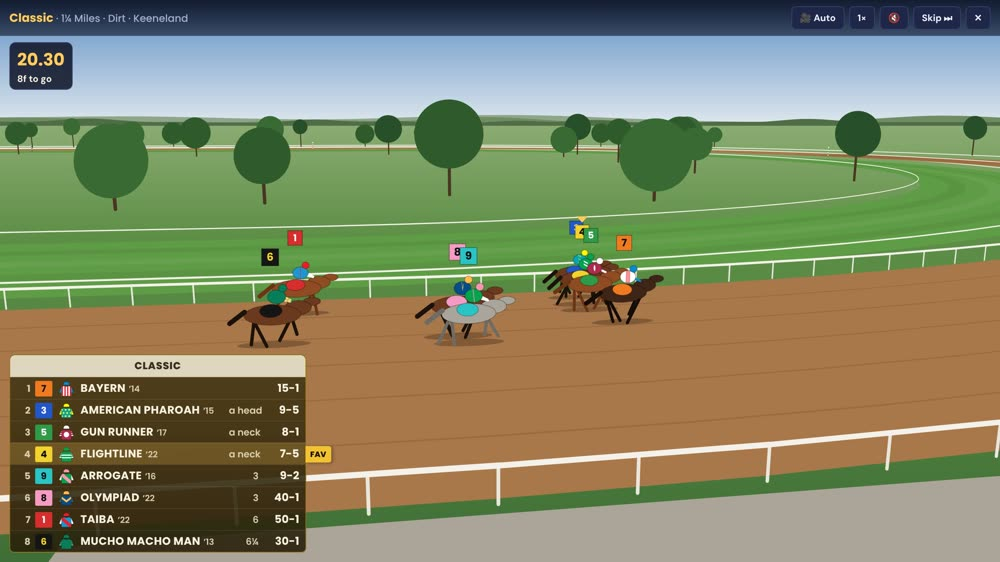
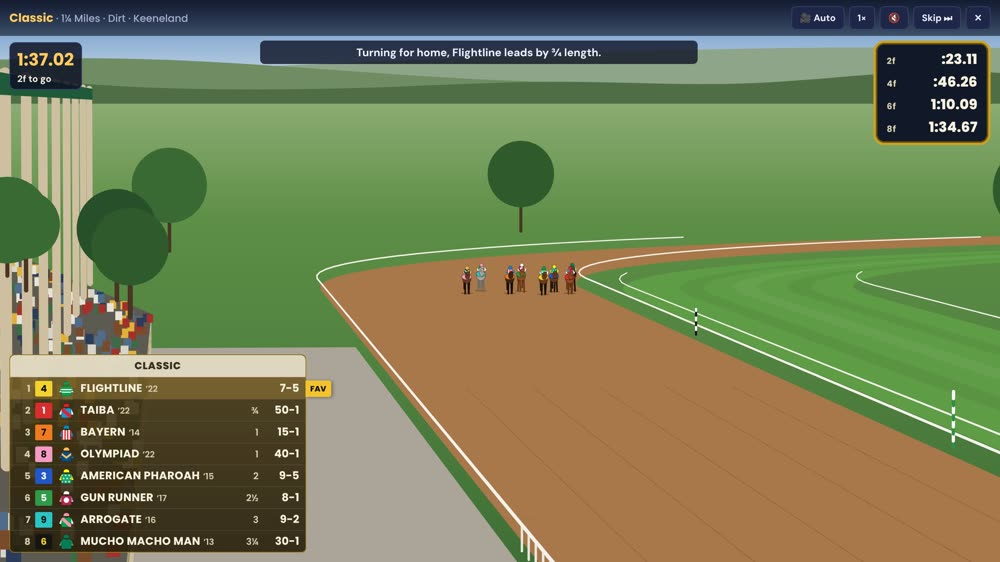
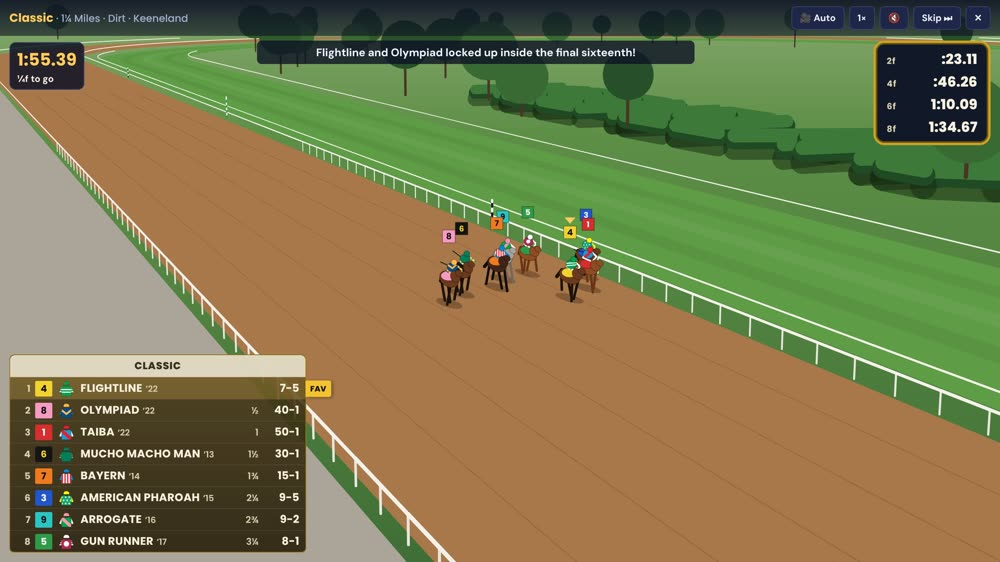
</div>
<p class="caption-text" style="text-align:center">One race, four camera shots: a Classic at Keeneland</p>



The sim decides the finishing order and the margins first, and then the race is animated so that it lands exactly there. Within that, each horse runs to its own style. Every horse carries how it actually ran in its Breeders' Cup - E (early speed), EP, S or C (a closer) - worked out from where it was at the first call, along with its real post. Speed horses go to the front, closers drop back, and the rivals tuck in towards the rail on the turns rather than circling the field.

Pace matters too. The game counts the front-runners in the field, and that sets how the race is likely to unfold: no speed and it's slow, three or more and it's hot. The sim then draws the pace for the day. In a dirt route with three or more front-runners, the pace collapses about a quarter of the time, and when it does, the speed horses lose ground and the closers gain it. I calibrated the size of that from past races, then centered it so it doesn't count twice (every horse's rating was already earned under its own race's pace). The fractions move with it - a hot Classic goes 22.61 and 45.46, a slow one 23.74 and 47.24, and both finish in 2:00.07 - and the box marks a quarter or half FAST or SLOW when it's off par for the track and trip.

If the top two are within half a length, the camera cuts to the finish line, the race slows down, and the PHOTO sign goes up. For the clip below, I set up Zenyatta and Blame to meet again at Churchill, with five other Classic horses from 2007 to 2012. It's a new race, not a replay. Blame still got there by a nose.



#### What it sounds like

On Breeders' Cup Friday, I noted that "the audio on the Watch experience is horrible". It was a flat band of noise for the crowd, evenly spaced ticks for the hooves, and a beeping bell. So it got rebuilt, still all generated in the browser with no audio files.

A racing gallop is four footfalls and then a moment with all four feet off the ground, at about two and a half strides a second. The eight nearest horses each land their four feet on that rhythm, at their own speed, with a different sound on dirt and on turf. The field is a rumble that swells as it passes and pans with it, and the hoofbeats come up into the stretch the way a broadcast opens its rail mics. The start is the latch, the gate doors clattering open and the bell. The crowd is 24 synthesized voices, chatting when it's quiet and shouting more and more from the top of the stretch. I tuned all of it against a real recording of a race, band by band, until the levels lined up.

<!-- CLIP NEEDED: ~20 s with sound, the start and a stretch run (controls=true). Needs a capture with audio. -->

#### The tracks

Each race runs at the track that hosted that year's Breeders' Cup. All 12 host tracks are modelled from their real dimensions, with a landmark or two: Churchill's twin spires, the San Gabriels behind Santa Anita, the ocean behind Del Mar.

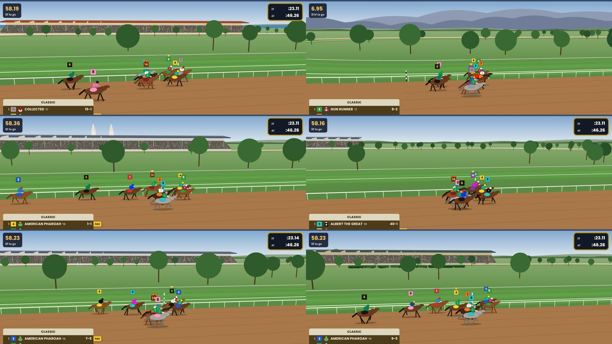
<p class="caption-text" style="text-align:center">Del Mar, Santa Anita, Churchill Downs, Belmont Park, Gulfstream Park and Keeneland</p>

### Making it a game

I'd always wanted to try generating a game. I'd seen developers on X build simple graphical games with AI - levelsio's [airplane game](https://404media.co/this-game-created-by-ai-vibe-coding-makes-50-000-a-month-yours-probably-wont) was the famous one - and I realized I could pair a simple game with 14–0. It would be easy to dip in and out of, but still backed by the depth of the data, and recognizable to a fan of the sport.

I asked Claude for "a very simple top down but slightly at an angle horse racing game". The very first version looked a lot like the game does today, except it was side-on. It was called Flatirons Park. Five minutes after it appeared, I wrote back: "The side-on view doesn't work, it needs to be from behind."

<div style="display:flex;gap:8px;flex-wrap:wrap;align-items:flex-start">
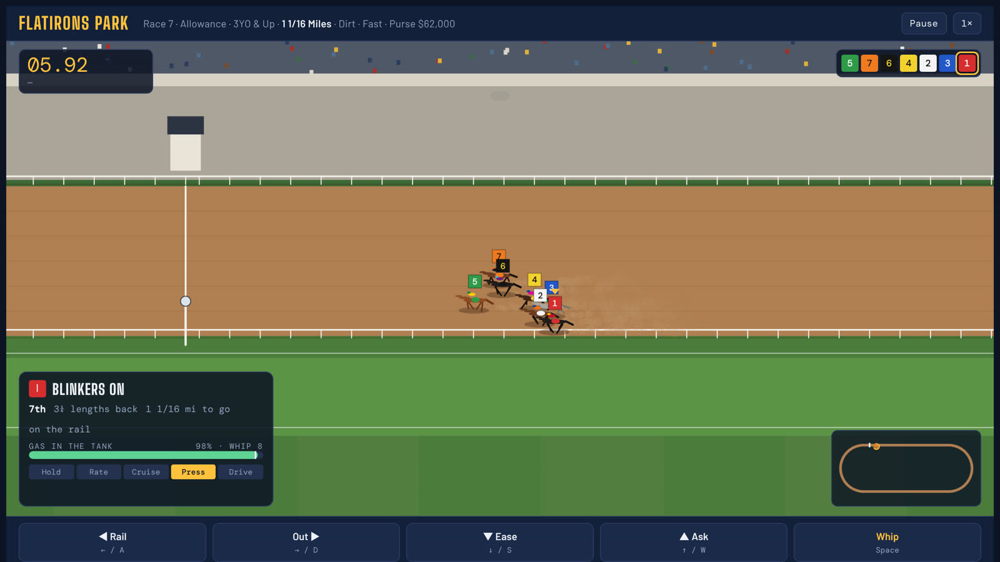
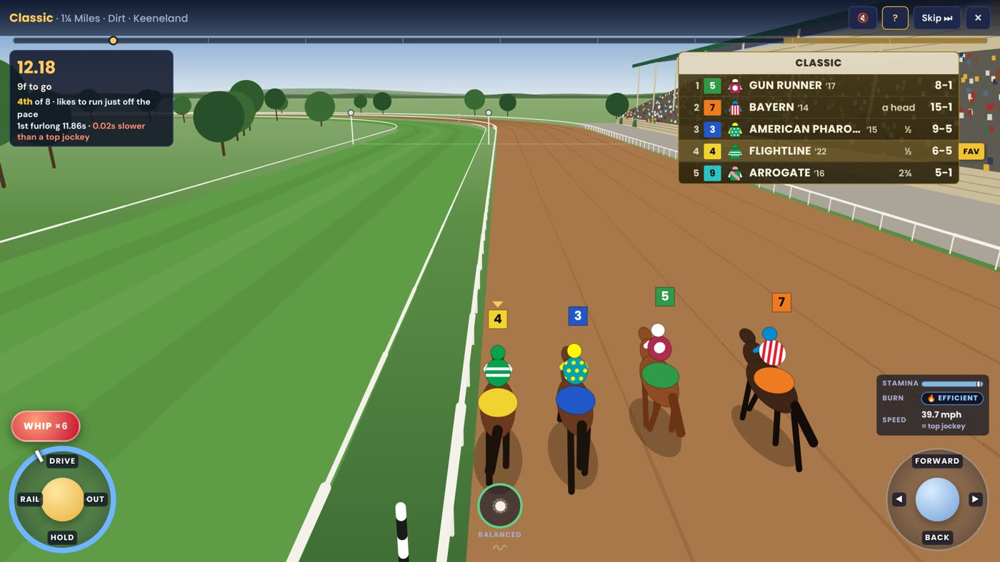
</div>
<p class="caption-text" style="text-align:center">Flatirons Park, 14 minutes after I asked for it, and the chase camera today</p>

### Riding a race

Riding was the hard part.

Before changing anything, I had the jockey games researched: G1 Jockey, Gallop Racer, Champion Jockey, and what reviewers and players found confusing or great about them. What they mostly agree on is that the rider needs to know what's left in the tank for the finish, how hard they're asking right now compared to what the horse wants, and where they are compared to where the horse likes to be.

I tried to model the controls on [*Winning Ways: Raceriding Insights*](https://www.theirishfield.ie/retired-jockey-and-coach-mick-kennedy-passes-away-425136) by Mick Kennedy, an Irish jockey who went on to teach young riders, and it just didn't feel right, especially the rhythm, where you had to keep a tempo.

<figure style="max-width:340px;margin:1.5em auto">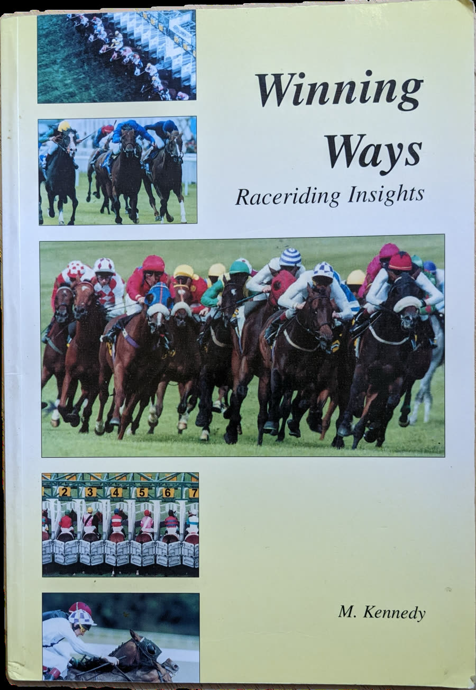<figcaption class="caption-text">My copy</figcaption></figure>

I was trying to do something more complicated than a mobile-first game should, and in testing I spent the whole race watching the controls instead of the horses. What got it unstuck was simplifying, and the commit history shows how long that took.

<figure style="margin:1.5em 0">

</figure>

The first ride mode, on the Tuesday evening, was one stick and a whip. By Wednesday morning it had been rebuilt around *Winning Ways*, rhythm taps and all. By that afternoon it was two sticks, one for balance and one for the reins, and the rhythm had become "soft hands". Then came one stamina pool with a ghost line, and then the whip, three ways in 40 minutes: a swipe, a press, and finally its own button.

Riding it on my phone a day later showed up the rest. The reins stick stayed wherever you left it, my thumbs covered the gauges, and the balance needed constant fiddling. So I went back to how real jockeys ride. A professional's crouch absorbs the stride, so balance takes care of itself until something happens. Whipping late isn't associated with better placings. And the great riders were known for quiet hands and few corrections. The controls now work like this:

- The **left stick is the reins**. Push up to ask for more, down to ease off, and let go and the horse keeps that effort.
- The **right stick is your balance**. It only moves when something happens - the turns, a bump, the whip, a tiring horse.
- The **whip** gets its own button, and only counts in the stretch, balanced, with something left in the tank.
- A **stamina** gauge shows what's left, with a ghost tick marking what a top jockey would have spent by this point for that horse and trip.

On a phone, the default is now one hand instead of two sticks. You swipe up to pump the reins (a small swipe is a heel click, a big one pushes on toward the drive), pull down to ease off, swipe sideways to steer, and double-tap to re-balance when a turn or a bump knocks you off. In the stretch, one big swipe up puts you in the drive, and you tap WHIP about once a second. The button for switching to two sticks works even mid-race. On a keyboard, it's W and S to ask and ease, A and D to steer, and the arrow keys for balance.

<figure style="max-width:320px;margin:1.5em auto">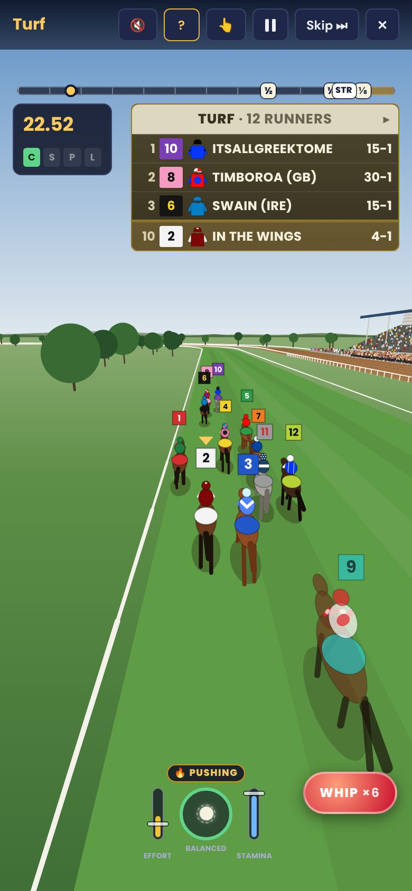<figcaption class="caption-text">Riding the Turf on a phone</figcaption></figure>

There's a position strip too, showing how many lengths you are off the lead, with your horse's preferred spot shaded. If you rush a closer up to the lead, or take back a front-runner to last, you pay for it. Ground you give away has to be won back in the stretch, and if it isn't won back by the wire, it counts at the wire.

<div style="display:flex;gap:8px;flex-wrap:wrap;justify-content:center">
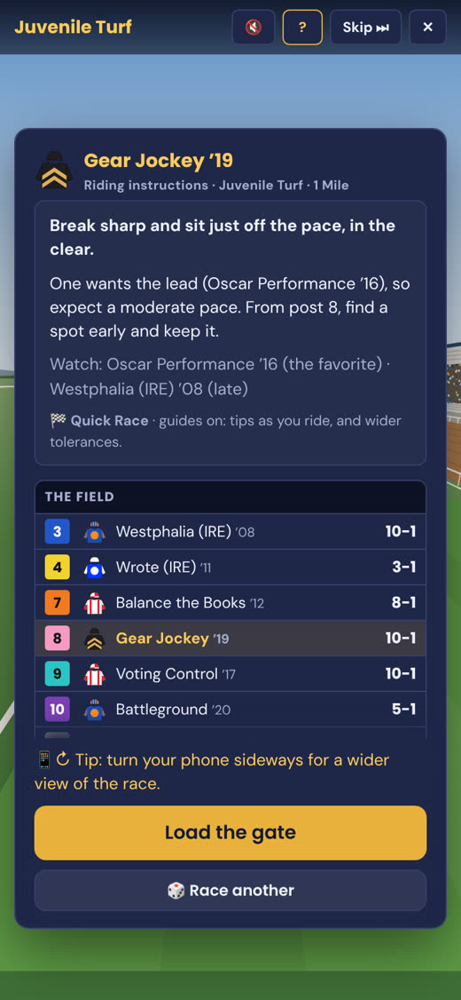
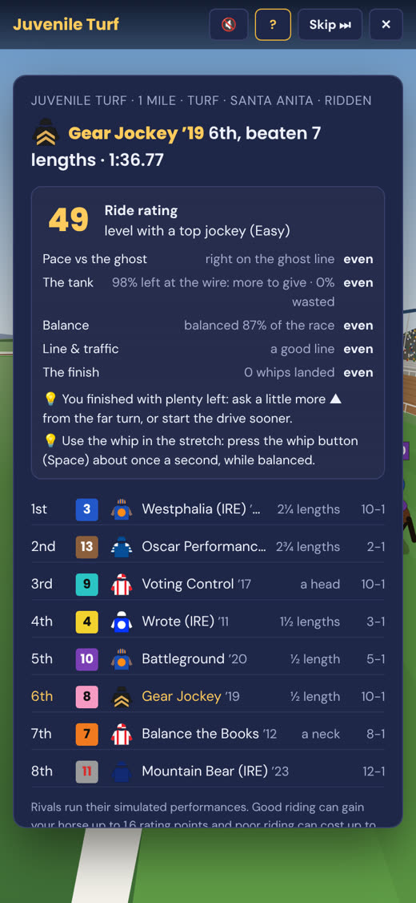
</div>
<p class="caption-text" style="text-align:center">The paddock briefing, and the report card</p>

Before each ride, a paddock briefing gives you the trainer's plan (with a Plan B), the pace to expect, and who to watch. Afterwards, a report card grades the ride.

#### What a ride is worth

Your ride is measured against what a top jockey would get from the same horse. A great ride gains up to 1.6 rating points. That cap exists because no ride should turn the wrong horse into a winner. The downside isn't capped in the same way, though. If you empty the tank half a mile out, the fade is real ground to the wire. The worst a ride can do is leave you beaten 25 lengths.

Every change to the ride gets checked the same way as the ratings. A set of scripted riders (ideal, decent, casual, idle, one that pushes the whole way, one that saws at the reins, one that goes wide) ride every division on both levels, and their results go back into the Monte Carlo. A good ride is worth a little more than simming, a decent one a little less, and riders who empty the tank get tailed off.

#### Temperament

Some horses had their own way of going, and the race charts say so. About 140 horses in the game carry a temperament from their Breeders' Cup chart: 49 keen, 15 relaxed, 3 lazy, and 84 that lugged in or out (some do both). I reviewed every one of those tags myself.

In ride mode, a keen horse left alone creeps up a gear, and if you try to hold it too hard, it fights you and burns stamina. A lazy horse sags, and answers the reins more slowly. A horse that lugged in through the final furlong in real life leans in late in your race, and you have to steer against it. The paddock briefing tells you which kind of horse you're on.

### What the game won't show

Horses get hurt in racing. It's a part of the sport, but it shouldn't be promoted within a game. There is no need to model injury in the game, and no benefit to it. So 14–0 never depicts an injury, a breakdown, a horse pulled up or eased, or anything vet-related, for any horse.

Four horses in the archive lost their lives in or after their Breeders' Cup: Go for Wand (1990), Pine Island (2006), George Washington (2007) and Mongolian Groom (2019). They're in the game because they were good enough to be there, but they carry their true talent only, nothing from that day, and they're never shown in any contact with another horse. Rivals are only ever drawn from the pool of horses the game offers you, so a horse that didn't finish can never be pulled into your race to lose.

Contact between horses is allowed. Horses drift, lug, brush, bump and get checked - those things happen in nearly every race - but only as incidents that cost ground. Nobody falls. And the race call never names a horse in an incident.

### This year's card

For the 2026 Breeders' Cup at Keeneland on October 30 and 31, the game had the real fields: all 14 races, with the real draw, posts, silks and running styles. You could ride or watch any of them, or watch all 14 in a row, at [14-0.net/bc26](https://14-0.net/bc26).



There's no history to rate a horse that hasn't run its Breeders' Cup yet, so the 2026 ratings come from the betting market instead. Each field is fitted so that the game's own draw gives each horse the chance its price implies, with the bookmakers' margin removed. The favorite is anchored at the level of the division's typical winner, and only the gaps inside the field matter. Those horses never get the player's edge either, and they can't be spun in the all-time game.

Odds are shown the way the track's country shows them: American at Keeneland (5-2, 7-2), fractional in Britain and Ireland, decimal elsewhere. So it's never British fractions at a US track.

Then there were the scratches. Every time a horse came out, the field was rebuilt, the remaining prices re-normalized, and a test that checks the card (field sizes, odds, silks, the multiplayer room sizes) had to pass before it went out.

### Multiplayer

<figure style="max-width:320px;margin:1.5em auto">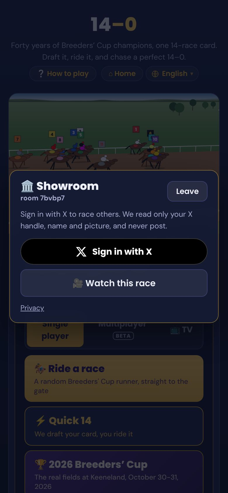<figcaption class="caption-text">The Showroom, mid-race</figcaption></figure>
<!-- SHOT NEEDED (needs a signed-in session): a room mid-race with X avatars on the horses, and the leaderboard -->

You can also ride against other people. Sign in with X, and your horse carries your X avatar on the track in place of the saddlecloth.

There are three ways in. The **Showroom** runs an all-time Breeders' Cup Classic, over and over, with a fresh draw of years each time. **Breeders' Cup 2026** runs this year's 14 races in card order. And a **private race** gives you a link to share, where the host picks the division and can make every horse equal, so it comes down to the riding. On Saturday, the **Featured Race** opened to everyone, following the real card: each real race got a room from 25 minutes before its post time to 10 minutes after it, with the same field you were watching on TV. Honestly, it didn't have much of an effect.

The interesting part, technically, is that the server never runs the race. Every random draw in 14–0 goes through one seeded generator, so every phone in a room draws exactly the same race from the room's seed: the field, each horse's performance, the pace, and which horse each rider gets. Each phone rides its own horse and sends where it is ten times a second, and the room relays that to everyone else. The AI horses run as drawn, as they do in the solo game.

At the wire, each phone sends its ride's account - the same bounded "nudge" a ride adds to or takes from the horse's drawn performance - and the official board is just performance plus nudge for every horse. Your screen might have shown a nose the other way, because you were seeing the others through the network's lag, but the board is the result. The schedule is a function of the clock (room ids have the post time in them), so there's no scheduler and no database.

Points are the places you beat, plus two for every place your ride gained over where that horse would have finished with nobody riding it. So a good ride on a poor horse can outscore a passenger on the favorite.

### 14–0 TV



[14-0.net/tv](https://14-0.net/tv) is the simplest thing in the game. It's this year's Breeders' Cup races, round the clock, raced with the real fields, and everyone watching sees the same race at the same time. Nobody rides and nobody signs in. After each race, the result card shows the winner, the winning distance and the odds, and then the next race is 30 seconds away. After the Classic, it shows all the winners. Big screens get big graphics, so it can be left running on a TV.

### Languages

<div style="display:flex;gap:8px;flex-wrap:wrap;justify-content:center">
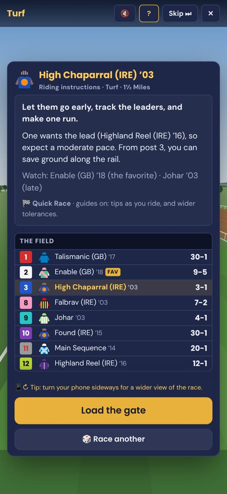
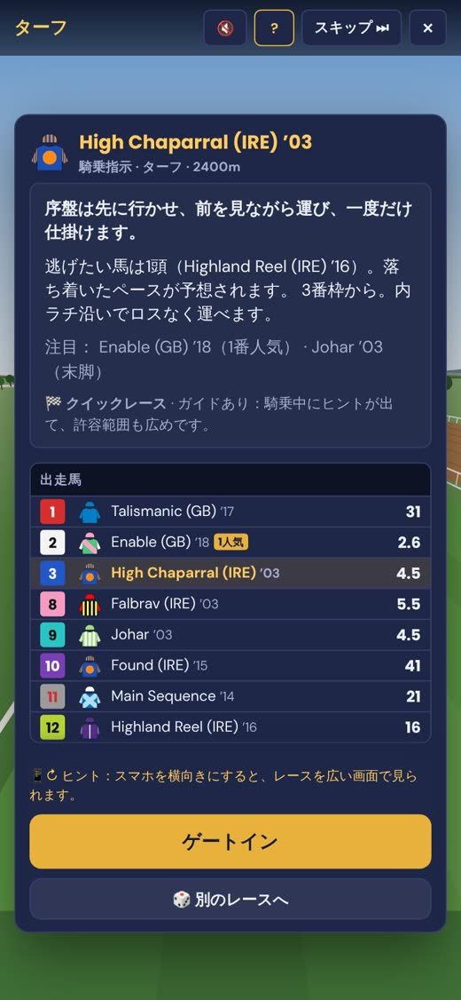
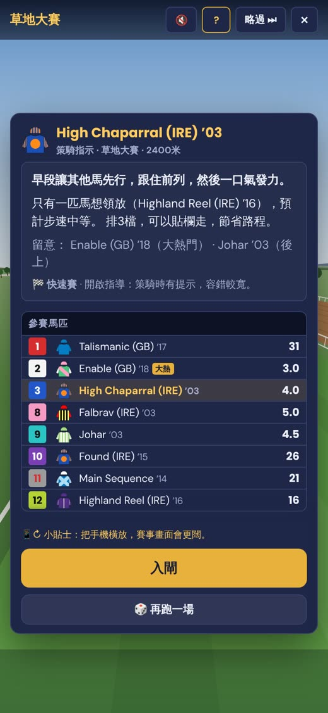
</div>
<p class="caption-text" style="text-align:center">The same paddock briefing in English, Japanese and Hong Kong Chinese</p>

The game plays in six languages: English, Spanish, French, German, Japanese and Hong Kong Chinese. The racing terms follow each country's own racing vocabulary (the Japanese uses JRA terms and the Chinese uses the Hong Kong Jockey Club's), and the race calls are spoken in each language. The language picker shows each language in its own name and script, with no flags, because a flag is a country and not a language.

### How it's built

All of 14–0 was authored by AI. I used Claude Code for all of it, from the first Flatirons Park prompt to the Featured Race. It was exceptional at finding reference information to use - the stride timing of a galloping Thoroughbred, how broadcast crews mic a race, how the old jockey games laid out their screens, what a real Breeders' Cup margin looks like. Taste, though, was still human.

The whole game is one HTML file and some JSON, served by a Cloudflare Worker that also draws a preview image for every shared card. Merging to `main` doesn't ship it. A release train ships whatever is on `main` every two hours, behind the full test suite, because every deploy restarts every multiplayer room. There's a pause on race days while the Featured Race runs. The test suite drives a full draft on desktop and a 375-pixel phone, checks that the same seed gives the same race, that no protected horse is ever in contact, that the 2026 card matches its prices, and that the public site only ever contains an exact list of files.

### Next

Next is the Melbourne Cup.



The 2026 Melbourne Cup is on Tuesday, November 3, at Flemington. [14-0.net/mc26](https://14-0.net/mc26) has the real field of 24, with the barriers and their own silks: pick a runner, then ride it or watch it, over 3,200 meters. The prices show the Australian way, with a dollar sign.

The riding version of 14–0 found its own audience. Over two days in Breeders' Cup week, people rode almost 600 quick races, and finished exactly one full 14-race draft.

**[Play 14–0 at 14-0.net](https://14-0.net)**, jump straight into a [Quick Race](https://14-0.net/race), or leave [14–0 TV](https://14-0.net/tv) running. Follow [@FourteenAndOApp](https://x.com/FourteenAndOApp) on X.
